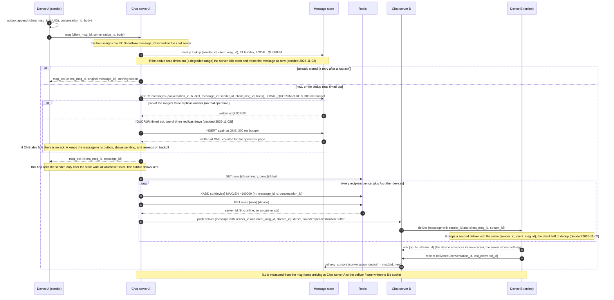
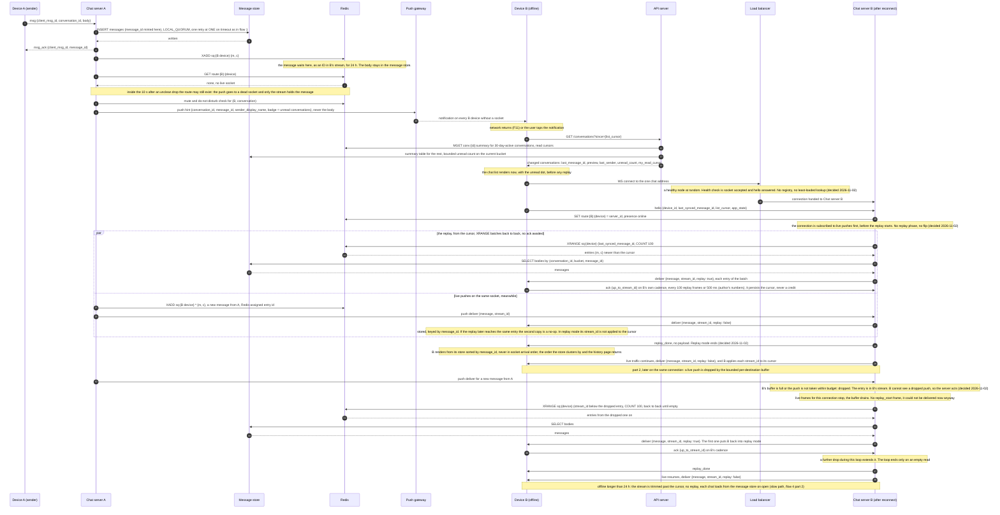
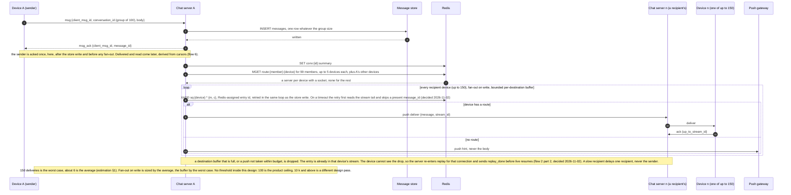
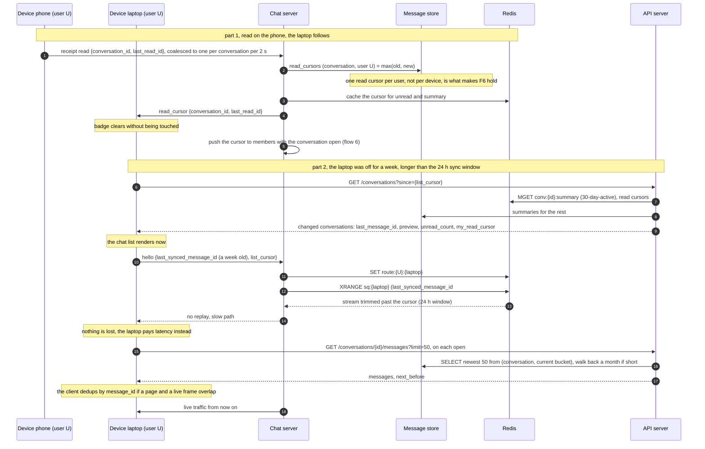
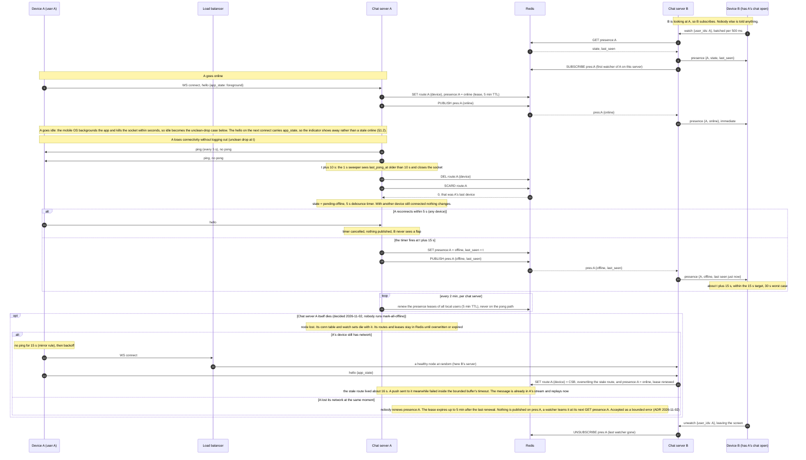
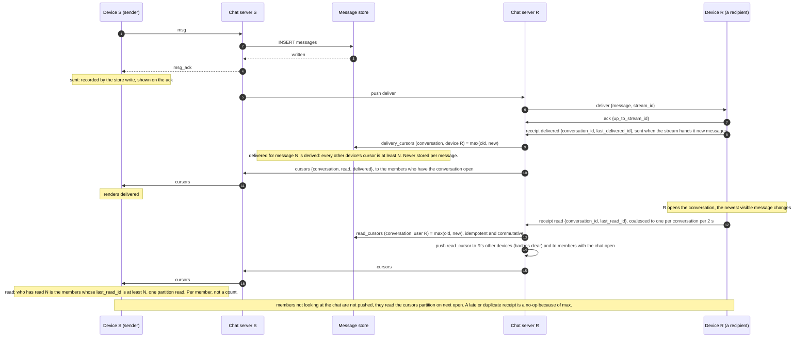
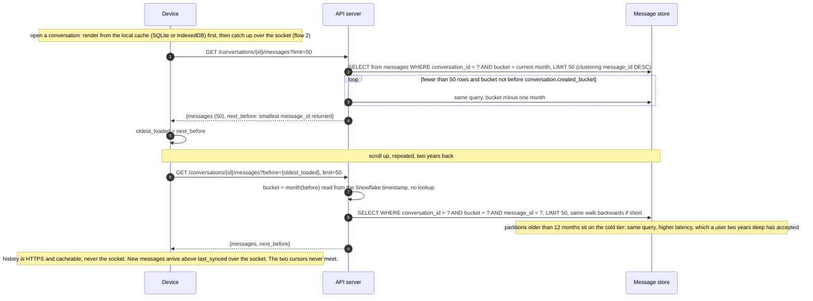
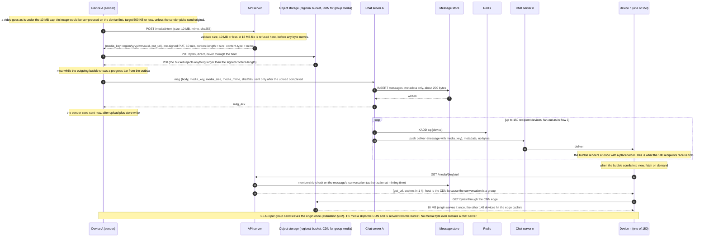
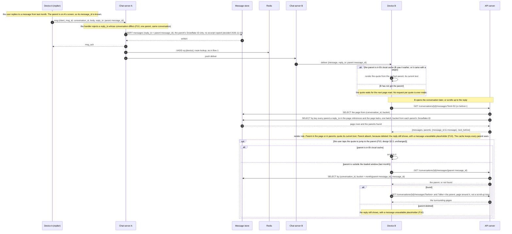

# Sequence diagrams — the nine flows of specification §4.2

One Mermaid `sequenceDiagram` per flow, drawn from [`design.md`](../design.md):
§1 (heartbeat, reconnect), §2.3 (history, jump to a parent), §3 (receipts, push),
§4.2–§4.4 (fan-out write order, reconnect as drawn), §5.4 (presence as drawn),
§6.2–§6.3 (media as drawn), and the fan-out decision on the discussion page
(Component 3). The questions under each heading are the spec's; the diagram answers
them in its notes. Open decisions appear as notes marked **open**, never as arrows.

Participants are the eight kinds the architecture has, and nothing else (the load
balancer joined on 2026-11-02 with the service-discovery decision; it appears only
where a device connects, flows 2 and 5):

| Participant | What it is in `design.md` |
|-------------|---------------------------|
| device | a phone, laptop or web client holding one WebSocket, an outbox and two cursors |
| API server | stateless HTTPS: history pages, conversation summary, media intent and URL minting |
| load balancer | one address for all chat servers; application-level health check (socket accepted, `hello` answered), random assignment; no registry behind it (§1.4, ADR 2026-11-02) |
| chat server | stateful: sockets, pong times, watch sets, fan-out on write |
| Redis | routing table `route:{user}:{device}`, sync streams `sq:{device}`, presence leases and pub/sub, summaries |
| message store | wide-column `messages`, `read_cursors`, `delivery_cursors`, dedup index; no primary, RF 3, LOCAL_QUORUM with one retry at ONE on timeout (§2.7, ADR 2026-11-02) |
| object storage | regional buckets, CDN in front of group media |
| push gateway | APNs / FCM |

A flow may show two instances of a kind (device A and device B, A's chat server and
B's chat server). When sender and recipient share a chat server the server-to-server
push in flows 1, 3, 6, 8 and 9 is a local socket write.

---

## Flow 1 · Send 1:1, recipient online

*Which hop assigns the message ID? Which hop acknowledges the sender?*

What it answers: the ID is minted on the sending chat server (§2.2, board Component 2);
the sender is acked by that same chat server after the store write and before any
fan-out (§4.2, write order store → ack → queue); the push to an online device is direct,
server to server, with no queue in the hot path (board Component 3). The store write
and the dedup read go at LOCAL_QUORUM; a range that has lost two of its three replicas
gets one retry at ONE before the ack, and a write that fails even then is not acked
(§2.7, decided 2026-11-02). The `deliver` frame carries `sender_id` and
`client_msg_id` so the client can drop a double from a fail-open dedup read.

## Flow 2 · Send 1:1, recipient offline

*Where does the message wait, how is the recipient notified, what happens on reconnect?*

What it answers: the message waits in Redis as an ID in the device's stream (§4.2),
with the body in the store; the recipient is notified by a push hint without the body
(§3.6); on reconnect the list comes from the summary read first and the messages from
the stream replay (§4.3, §4.4). The replay and live pushes share the socket from the
`hello` on: live first, then replay, no flip, so nothing appended during the replay is
skipped; the client dedups and sorts by `message_id`, and the device cursor takes a
live frame's `stream_id` only outside replay mode (§4.4, decided 2026-11-02). Replay mode
begins at `hello` and ends at `replay_done`; `deliver.replay` tells the two kinds of
frame apart, and `ack{up_to_stream_id}` persists the cursor on the client's own cadence
and is never a flow-control credit (§4.7). Part 2 draws the one way the connection
re-enters replay mode: a push dropped by the backpressure budget, after which the server
re-runs the replay alone from the dropped entry and sends `replay_done` before live
resumes (§7.8, decided 2026-11-02).

## Flow 3 · Send to a group of 100

*How is the fan-out performed, and at what point does the sender get an ack?*

What it answers: fan-out on write by the sending chat server (board Component 3); the
ack is sent once, after the store write and before the fan-out (§4.2); backpressure is
the bounded per-destination buffer with drop-to-stream (board Component 3, not yet in
`design.md`, routed to A3).

## Flow 4 · Multi-device sync

*A message read on the phone shows as read on the laptop. A device off for a week
comes back: how does it catch up?*

What it answers: one read cursor per user, pushed to the reader's other devices (§3.5);
a device beyond the 24 h window gets the chat list from the summary at once and loads
each conversation from the store on open (§4.2, §4.3, §4.7).

## Flow 5 · Presence

*User goes online, goes idle, loses connectivity without logging out. How do friends
learn about it, and how fast?*

What it answers: only watchers learn (§5.1, §5.3); detection within 10 s, visible
within 15 s, 30 s worst case, a drop under 5 s never shown (§5.2, §5.4); the Redis lease
is off the pong path and exists only for a dead chat server (§1.5, §5.5).

## Flow 6 · Message status: sent, delivered, read

*Who records each transition and who is notified?*

What it answers: sent is recorded by the store and shown on the ack; delivered and read
are cursors written by the recipient's chat server (§3.3); the sender and anyone with
the chat open are notified, nobody else (§3.4); status is derived from the cursors,
never stored (§3.3).

## Flow 7 · Load chat history

*Open a conversation and page back through two years of messages.*

What it answers: newest 50 from the current month's partition, cursor paging by
`before`, the bucket chosen from the Snowflake timestamp (§2.3); history never rides
the WebSocket (§2.1); old partitions are on a cold tier (§2.5).

## Flow 8 · Send media to a group

*A 10 MB video to a 100-person group. Upload path, where the bytes live, what the 100
recipients receive first, and when the sender sees "sent".*

What it answers: upload is direct to object storage with a pre-signed PUT, the cap
enforced at the intent step and by the bucket (§6.1, §6.2); the bytes live in a
regional bucket (§6.4); recipients first receive the message with a `media_key` and
fetch on demand (§6.2, §6.3); the sender sees sent after the upload and the store write
(§6.2).

## Flow 9 · Reply to a message

*User replies to a message from last month. Is the quoted excerpt stored with the reply
or fetched by ID on render? What happens when the parent is outside the device's local
cache?*

What it answers: `reply_to` is stored as the parent's ID and nothing else (§2.2); the
quote is resolved from the parent on render, with the page API carrying the referenced
parents in one batched key read and the deleted-parent placeholder as a render rule
(§2.3, ADR 2026-11-02); a parent outside the loaded window is fetched by key and paged
around only when the user jumps to it (§2.3).
